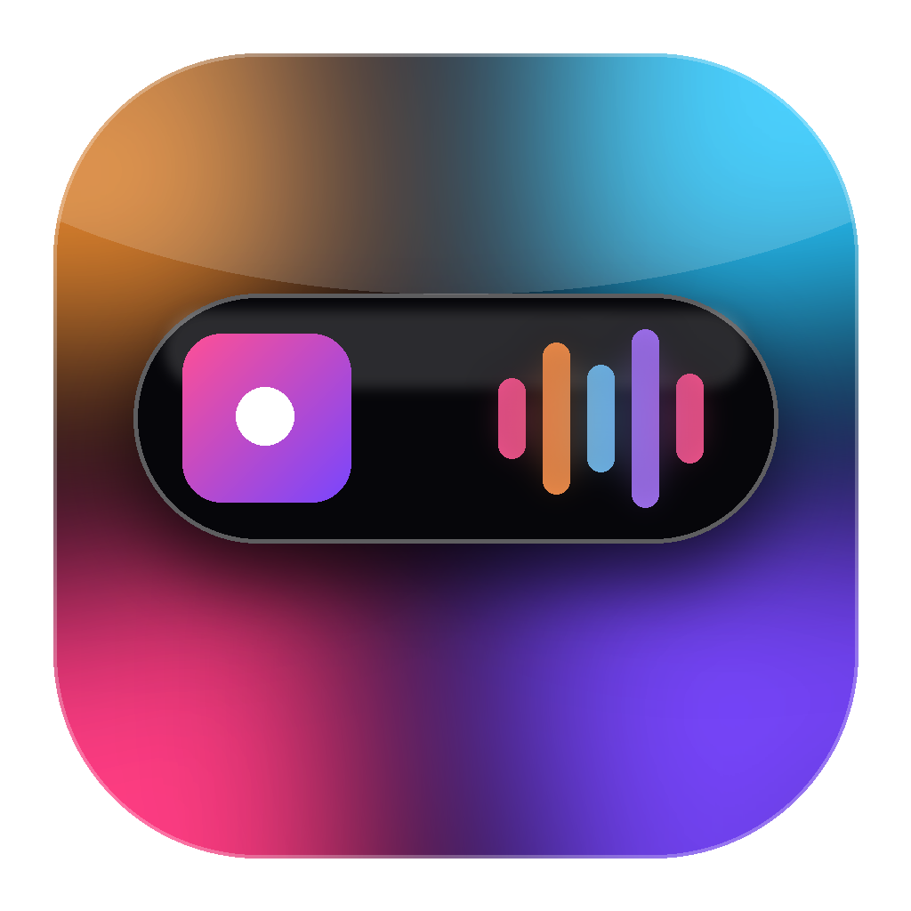

<p align="center"></p>

# MiIsla

**ES** · Una isla flotante para tu Mac (sin notch), con Apple Music y YouTube Music, animación de AirPods, carga, volumen y un widget de música para la pantalla de bloqueo. Gratis y de código abierto (MIT).
**EN** · A floating, notch-style island for Macs without a notch: Apple Music and YouTube Music, AirPods connect animation, charging, volume HUD and a lock-screen music widget. Free and open source (MIT).

> Proyecto independiente, no afiliado a Apple Inc. / Independent project, not affiliated with Apple Inc.
> Apple, Apple Music, AirPods, Mac y Dynamic Island son marcas de Apple Inc.

Requiere / Requires: **macOS 14+**. Para compilar: Xcode o Command Line Tools (Swift 5.9+).

---

## Español

### Qué hace
- Píldora negra arriba al centro (en la pantalla principal) con animaciones de resorte y difuminado.
- **Apple Music** y **YouTube Music** (en Chrome, Brave, Edge, Arc, Vivaldi, Safari): portada, título, artista, tiempo, controles, favoritos y barra para saltar. La portada da una vuelta al cambiar de canción.
- **Un clic en la isla** (o el botón con el icono de la app) abre Música, o el navegador en la pestaña de YouTube Music.
- **AirPods / Beats**: animación 3D al conectar y batería. **Carga**: rayo y batería que se llena. **Volumen**: barra con la salida de audio.
- **Pantalla de bloqueo** (experimental): tarjeta de cristal y vista completa estilo Apple Music con fondo de la portada, reloj y letras sincronizadas.
- Se oculta con Mission Control y con apps en pantalla completa.
- Bandeja de archivos: arrastra archivos a la isla.

### Instalar
1. Descarga `MiIsla-x.y.z.zip` de [Releases](../../releases), descomprime y arrastra `MiIsla.app` a Aplicaciones.
2. La app no está notarizada (no pago la licencia de desarrollador): la primera vez, **clic derecho → Abrir**. Si macOS la bloquea: Ajustes del Sistema → Privacidad y seguridad → "Abrir de todos modos".
3. Acepta los permisos de Automatización (Música) y Bluetooth. Detalles en [PRIVACY.md](PRIVACY.md).

### Compilar tú mismo
```bash
git clone <este repo> && cd MiIsla
./build_app.sh            # crea MiIsla.app (firma ad hoc, gratis)
open MiIsla.app
```
Para que macOS recuerde los permisos entre versiones, firma con tu Apple ID: `./build_app.sh "Apple Development: Tu Nombre (XXXXXXXXXX)"` (`security find-identity -v -p codesigning`).
Para generar el zip de release: `./release.sh 1.1.0`.

### YouTube Music (una sola vez)
- Chrome / Brave / Edge / Arc: menú **Ver → Desarrollador → Permitir JavaScript desde Eventos de Apple**.
- Safari: Ajustes → Avanzado → "Mostrar funciones para desarrolladores web"; luego **Desarrollo → Permitir JavaScript desde Eventos de Apple**.
Se puede apagar en el menú de la cápsula ("Detectar YouTube Music").

### Letras
Vienen de [lrclib.net](https://lrclib.net) y lyrics.ovh. Hay un interruptor opcional para NetEase (servicio no oficial, apagado por defecto) en el menú de la cápsula. Si una canción no tiene letra sincronizada, se reparte la letra simple por la duración y se marca como aproximada. Las letras propias de Apple Music y las portadas animadas solo existen vía MusicKit (requiere cuenta de desarrollador de pago), así que no están incluidas.

### Imágenes de AirPods
El proyecto no incluye fotos de productos de Apple; usa los iconos del sistema. Si quieres tu propia foto (PNG con fondo transparente), ponla en `~/Library/Application Support/MiIsla/` como `airpodspro.png`, `airpods.png` o `airpodsmax.png`, o en la carpeta `Personal/` del repo (ignorada por git) y `build_app.sh` la copia.

### Limitaciones honestas
- La pantalla de bloqueo usa **APIs privadas** (SkyLight). Pueden cambiar en cualquier versión de macOS y **impiden publicarla en la Mac App Store**. Se apaga desde el menú.
- "No molestar" en el bloqueo necesita Acceso total al disco.
- Distribución notarizada requiere Apple Developer ID (99 USD/año).
- No lo he podido compilar yo mismo en macOS en cada cambio; si Xcode marca un error, abre un issue con el texto.

### Archivos
| Archivo | Qué hace |
|---|---|
| `AppDelegate.swift` | Ventana flotante, menú, Mission Control / pantalla completa |
| `Geometry.swift` | Tamaños y posición (`topGap`, `pillH`) |
| `IslandView.swift` | La interfaz de la isla |
| `MusicManager.swift`, `YouTubeMusic.swift` | Apple Music y YouTube Music |
| `Lyrics.swift` | Búsqueda de letras |
| `LockWidget.swift`, `SkyLight.swift`, `LockStatus.swift`, `LockSettings.swift` | Pantalla de bloqueo |
| `AirPodsManager.swift`, `PowerManager.swift`, `VolumeManager.swift`, `AudioOutputManager.swift` | AirPods, carga, volumen, salida de audio |

---

## English

### Features
Floating island on the main display; Apple Music + YouTube Music (browser) with artwork, controls, favorites and seeking; click the island (or the app-icon button) to open the music app; AirPods 3D connect animation with battery; charging and volume HUDs; experimental lock-screen widget with synced lyrics; hides in Mission Control and full-screen apps; file shelf.

### Install
Download the zip from Releases, drag `MiIsla.app` to Applications. It is **not notarized**: right-click → Open the first time. Grant Automation (Music) and Bluetooth permissions. See [PRIVACY.md](PRIVACY.md).

### Build
```bash
./build_app.sh      # ad-hoc signed MiIsla.app
./release.sh 1.1.0  # dist/MiIsla-1.1.0.zip + sha256
```

### Notes
- Lyrics: lrclib.net, lyrics.ovh, optional unofficial NetEase (off by default). Apple's own lyrics and animated artwork require MusicKit (paid developer account) and are not included.
- Lock-screen support relies on **private macOS APIs** (SkyLight): it may break with any macOS update and rules out the Mac App Store.
- No Apple product imagery is bundled; AirPods art falls back to SF Symbols. Drop your own PNGs in `~/Library/Application Support/MiIsla/` if you want.

## Licencia / License
MIT — ver / see [LICENSE](LICENSE).
